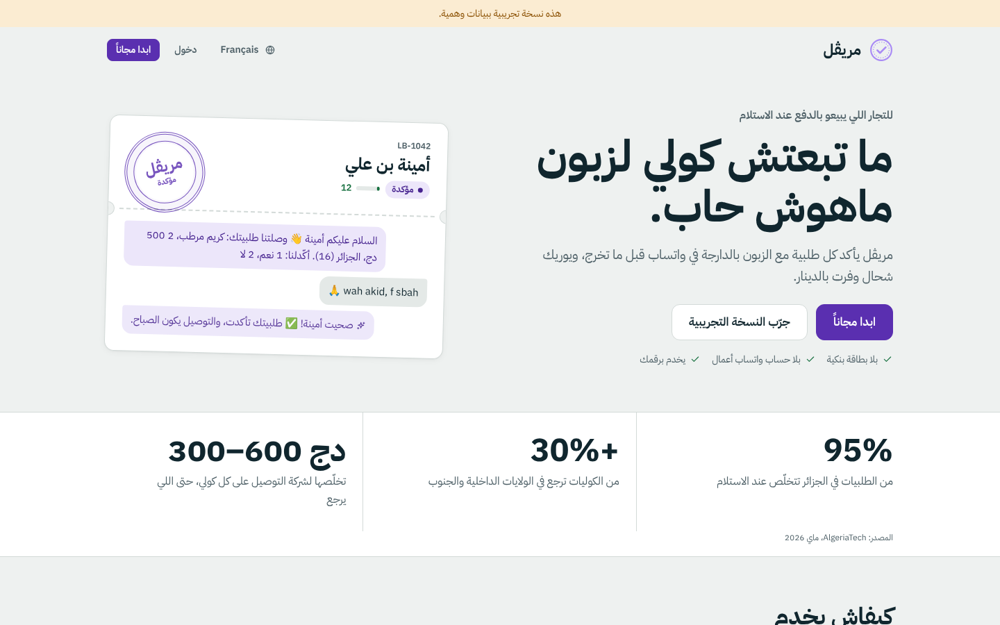
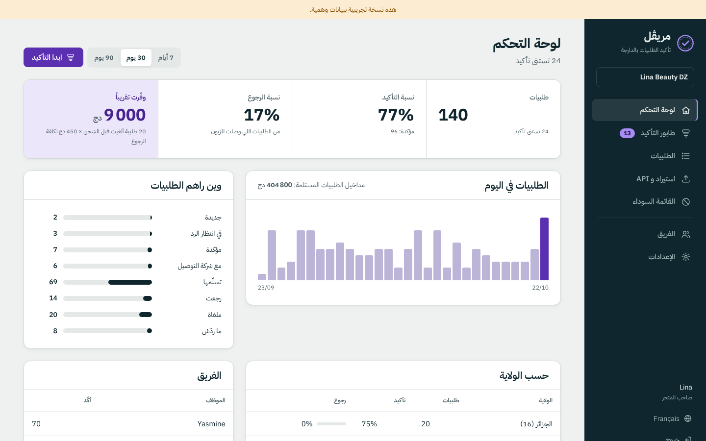
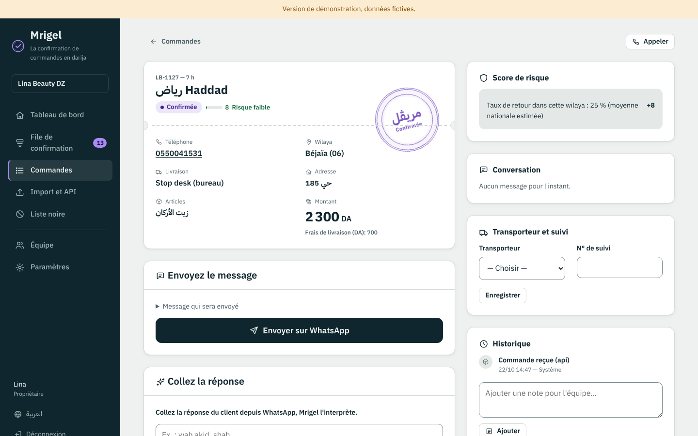
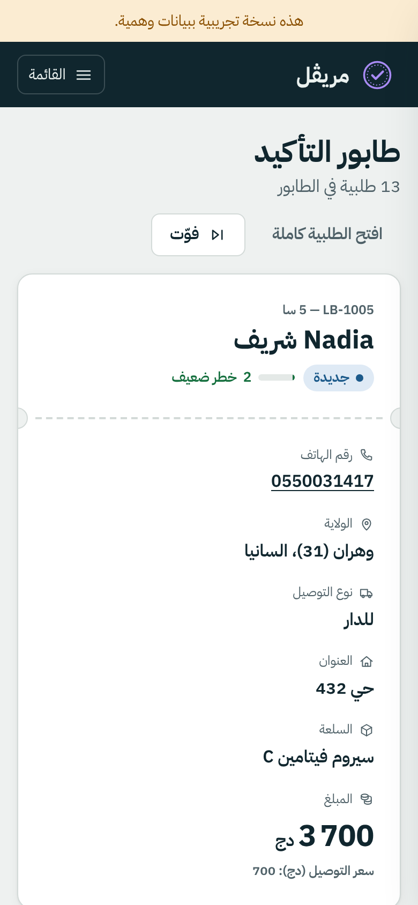

# مريڨل · Mrigel

**تأكيد طلبيات الدفع عند الاستلام بالدارجة في واتساب، قبل ما تخرج الكولي.**
Confirmation des commandes en paiement à la livraison, en darija sur WhatsApp, avant l'expédition.



## علاش

في الجزائر حوالي 95% من الطلبيات تتخلّص عند الاستلام. بين 15 و20% من الكوليات ترجع في المدن الكبرى، وأكثر من 30% في الداخل والجنوب، وشركة التوصيل تاخذ 300 إلى 600 دج على كل كولي حتى اللي يرجع. تأكيد الطلبية قبل الشحن ينقّص المرتجعات بـ 8 إلى 15 نقطة (AlgeriaTech، ماي 2026).

## واش يدير

- **يفهم الدارجة**: «واه»، «wah akid»، «1»، «la ma nhabch»، «ghodwa»، «bedel l'adresse»… بالعربية، بالأرقام (3، 7، 9) وبالفرنسية.
- **يخدم برقمك العادي**: ضغطة وحدة وواتساب يتحل على تلفونك بالرسالة جاهزة. بلا حساب Meta وبلا مصاريف بالدولار. ومع الوقت تربط WhatsApp Cloud API وكلش يمشي وحدو.
- **يجاوب الزبون**: «وقتاش تلحق؟»، «شحال التوصيل؟»، «كاين ستوب ديسك؟» من معلومات الطلبية، والأسئلة الأخرى بـ Gemini إذا حطيت مفتاح.
- **درجة خطر لكل طلبية** مع السبب: رقم غالط ولا ثابت، زبون رجّع من قبل، قائمة سوداء، طلبية مكررة، ولاية فيها الرجوع بزاف، مبلغ كبير.
- **طابور تأكيد** للموظفين: طلبية بطلبية، أزرار كبار، يخدم مليح على التلفون.
- **69 ولاية**، ستوب ديسك ولا للدار، وقت التوصيل (الصباح / العشية)، عربون للطلبيات الغالية.
- **لوحة تحكم بالدينار**: نسبة التأكيد، نسبة الرجوع، شحال وفّرت، حسب الولاية وحسب الموظف.
- **من أي مصدر**: طلبية بيدك، ملف CSV من Excel (عربي ولا فرنسي)، ولا API من موقعك.
- **تصدير لشركات التوصيل**: Yalidine، ZR Express، Maystro، NOEST، Ecotrack.
- **العربية والفرنسية**، من اليمين لليسار، والوضع الليلي.

| | |
| --- | --- |
|  |  |



## التشغيل على جهازك

```bash
python -m venv .venv && source .venv/bin/activate      # Windows: .venv\Scripts\activate
pip install -r requirements.txt
cp .env.example .env                                   # عمّر SECRET_KEY
DEMO_MODE=1 uvicorn app.main:app --reload
```

افتح http://localhost:8000 واضغط «جرّب النسخة التجريبية» (140 طلبية وهمية)، ولا افتح حساب جديد.

## النشر (مجاناً)

**Render**: New → Blueprint → اختار هذا الـ repo. الملف `render.yaml` يجهّز الخادم وقاعدة بيانات Postgres.
أي استضافة تقبل Docker تخدم (Railway، Fly.io، ولا مستضيف جزائري). المتغيرات كاملة في `.env.example`.

> البيانات الشخصية لزبائن جزائريين يحكمها القانون 18-07. للإنتاج، استضافة داخل الجزائر أحسن.

## ربط موقعك (API)

```bash
curl -X POST https://YOUR-APP/api/v1/orders \
  -H "X-Api-Key: mrg_..." -H "Content-Type: application/json" \
  -d '{"external_id":"A-1042","customer_name":"Amina","phone":"0555 12 34 56","wilaya":16,
       "items":[{"name":"Crème","qty":1,"price":2500}],"delivery_fee":400}'
```

المفتاح في صفحة «استيراد و API». نفس `external_id` مرتين = نفس الطلبية (ما تتكررش).

## WhatsApp Cloud API (اختياري)

في الإعدادات اختار «WhatsApp Cloud API» وحط Phone number ID، Access token، App secret وVerify token، ثم حط رابط الـ Webhook (يبان في الإعدادات) في تطبيق Meta. الردود تتفهم وحدها، والمتابعة تتبعت كل ساعتين للي ما ردّش (حتى 3 مرات).

## الاختبارات

```bash
pip install -r requirements-dev.txt && python -m playwright install chromium
pytest                 # 99 اختبار
pytest e2e             # المسار الكامل في متصفح حقيقي
```

## المجلد `replica/`

دراسة المنافسين (eGrow، COD Rocket)، خطة البناء، التصميم، الاختبارات والأخطاء المصلّحة: `recon.md`، `fixes.md`، `architecture.md`، `brand.md`، `test-plan.md`، `bugs.md`، `parity.md`.

---

### Français (résumé)

Mrigel aide les e-commerçants algériens en paiement à la livraison à confirmer chaque commande avec le client, en darija sur WhatsApp, avant l'expédition. Mode assisté avec votre propre numéro (aucun compte Meta requis) ou API WhatsApp Cloud ; compréhension des réponses en darija ; score de risque par commande ; file de confirmation ; tableau de bord en dinars ; 69 wilayas ; import CSV, API et export pour les transporteurs. Interface en arabe et en français.

Démarrage : `pip install -r requirements.txt`, puis `DEMO_MODE=1 uvicorn app.main:app --reload` et ouvrez http://localhost:8000.

Stack : Python 3.12, FastAPI, Jinja2, SQLAlchemy (SQLite ou PostgreSQL), aucun build JavaScript.
